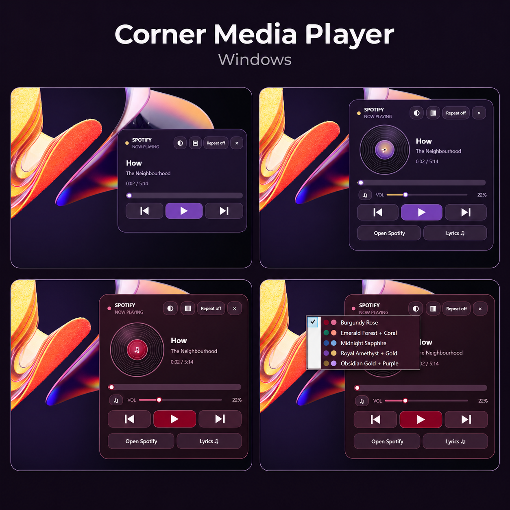
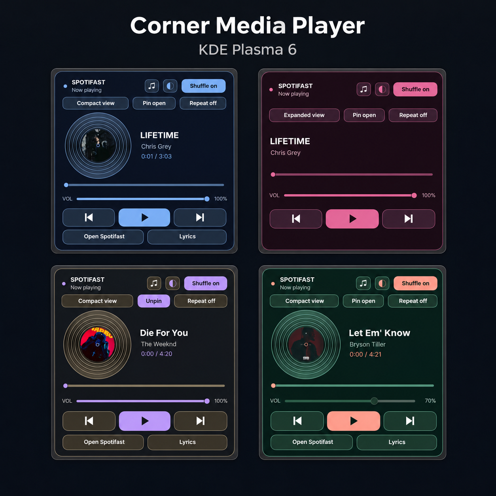

# Corner Media Player

A lightweight desktop music controller with native implementations for Windows and KDE Plasma 6. The display and playback controls work with an existing media application; Corner Media Player does not stream music. It currently supports active Windows media sessions on Windows and Spotify or Spotifast on Plasma 6; it is not a general-purpose audio player.

> **Latest: [v1.5.1 (Linux)](https://github.com/Ali7488/Spotify-Corner-Player/releases/tag/1.5.1).** Linux compact view is now title + transport controls only, with a small Expand button; expanded utility controls use 28px icons and hover tooltips. **Windows remains [v1.5.0](https://github.com/Ali7488/Spotify-Corner-Player/releases/tag/1.5.0)** with the same code and installer.

| Platform | Implementation | Media source |
| --- | --- | --- |
| Windows 10/11 | PowerShell 5.1, WPF, Windows media sessions | Auto-detected active Windows media player (Spotify supported; other apps as exposed by Windows) |
| KDE Plasma 6 | QML / Qt Quick, KDE Plasma and MPRIS | Spotify or Spotifast |

The platform versions are packaged as **separate ZIPs**, each including an MIT license copy. The Linux-only v1.5.1 patch is a separate release; the Windows v1.5.0 ZIP remains available from its prior release. They are not one cross-platform binary, and there is no mandatory background web service.

## Screenshots

### Windows



### KDE Plasma 6



## Features

Both versions offer:

- Five dark themes, selectable from the popup: Burgundy Rose, Emerald Forest/Coral, Midnight Sapphire, Royal Amethyst/Gold, Obsidian Gold/Purple
- Animated original decorative vinyl record that follows playback state
- Track metadata, play/pause, previous/next, a lyrics web-search shortcut
- Compact/expanded UI (new in v1.4)
- Repeat controls only when exposed by the selected media session (new in v1.4)
- Per-user installation and preservation of existing settings

**Windows:** right-edge drawer, tray menu, `Ctrl+Shift+Q`, a saved **Pin / Unpin** toggle (unpinned dismisses on click-away), smaller compact / pin / repeat / shuffle controls, and **active-media-session auto-detection**. Seeking, repeat and shuffle work only if supported by the selected Windows media session. Spotify-specific volume/mute is intentionally disabled when another player is selected. Windows does not display album artwork because its earlier thumbnail loading was unstable.

**KDE Plasma 6:** a true title-and-transport-only compact view (with a small Expand icon), 28px symbolic expanded utility actions with hover tooltips, and a persistent display toggle between **stationary original square album artwork** and **spinning original-artwork-free vinyl**, smaller compact/pin/repeat/shuffle buttons, Spotify/Spotifast/Auto session selection, per-player MPRIS volume, and Pin open/Unpin. Auto follows the playing supported player. The original album cover is never cropped, masked, or rotated by this widget. See [Linux setup and compatibility notes](linux/plasma6/README.md).

Repeat, shuffle, seeking, and player selection may be limited by the capabilities exposed through operating-system media interfaces. The widget cannot force support that the player has not implemented.

## Installation

### Windows

Download the **complete Windows ZIP**, extract, and double-click `Install.bat`. Do not run the source script from inside a compressed ZIP. Install uses the current Windows user account and does not require Administrator.

The player is accessible through the middle-right edge, the tray icon, or `Ctrl+Shift+Q`. Select themes, compact mode, and Pin / Unpin from the popup. When unpinned it retracts after focus moves to another application; pinned stays visible.

Run `Uninstall.bat` to remove the installed app and startup shortcut. `Restore-v1.2.4.bat` is included as an emergency fallback.

### KDE Plasma 6 (Linux)

Download the **Plasma6 ZIP**, extract and run the installer under your normal desktop user:

```bash
cd Corner-Media-Player-Plasma6
python3 install.py --check
python3 install.py
```

Open Plasma **Edit Mode → Add Widgets → Corner Media Player (Plasma 6)**. The applet requires Plasma 6 and at least one installed Spotify/Spotifast application. The installer refuses to modify any widget files if the prerequisite check fails.

The Linux widget preserves its existing Corner Media Player plugin ID and saved settings during an in-place upgrade. New artwork display preference defaults to Vinyl. It has a separate package ID from the original Emerald Vinyl, so the original is not removed or overwritten. You may remove the old widget manually after confirming the new one works.

## Safe upgrades, including manually installed v1.2.4

**Do not uninstall old versions by deleting guessed folders or killing all Spotify processes.**

Windows v1.4 installs to the same per-user `%LOCALAPPDATA%\SpotifyCornerPlayer\Spotify-Corner-Player.ps1` as the older scripts. This includes manually installed versions that **did not come from GitHub Releases**, such as v1.2.4. The installer:

1. Verifies the owner marker `SpotifyCornerPlayer/1` and checks any existing startup shortcut belongs to this app.
2. Stops only the existing Spotify Corner Player instance via its per-user stop event (not Spotify itself).
3. Creates a timestamped backup of the previous installed player and startup shortcut.
4. Replaces the installed script and startup entry in place, rather than leaving a second version installed.
5. Restores the previous script/shortcut if the new app cannot start. It attempts to relaunch the old app.
6. Preserves existing themes, diagnostic logs and other per-user settings.

To inspect without changing anything, use Windows PowerShell 5.1 from the extracted directory:

```powershell
powershell.exe -NoProfile -STA -ExecutionPolicy Bypass -File .\Setup.ps1 -Mode Check
```

This detects the old owned script by its installed contents, **not by where the ZIP was downloaded**. Unrecognized folders, startup entries or links are refused; an unidentified or unrelated application is never silently deleted. If someone copied the player script into an unrelated location and ran it without installing, there is no safe automatic uninstall guarantee.

Linux upgrades only the matching Plasma package ID and creates a backup under `~/.local/state/spotify-corner-player/backups/`. The installer never removes another widget or application.

## Build and validation

From a checkout containing the complete source:

```bash
bash Build-Release.sh
python3 -m unittest discover -s linux/plasma6/tests -v
python3 linux/plasma6/build-release.py
```

Windows PowerShell 5.1 parsing, WPF XAML checks, ownership/migration fixtures, Linux Python tests, QML parsing, and ZIP integrity run in GitHub Actions. These checks do not substitute for running the interfaces on real desktops.

The project does not manage Spotify accounts, send telemetry, or stream music independently. The Linux Artwork mode shows the original square media-session artwork without animation; Vinyl mode is a decorative drawing and does not embed album artwork. All music playback remains with Spotify or Spotifast. The program is unofficial and not affiliated with Spotify or KDE.


## License

Licensed under the [MIT License](LICENSE). Copyright (c) 2026 Mohannad Ali. This license applies to this project's code, not to Spotify, Spotifast, or the media they play.
